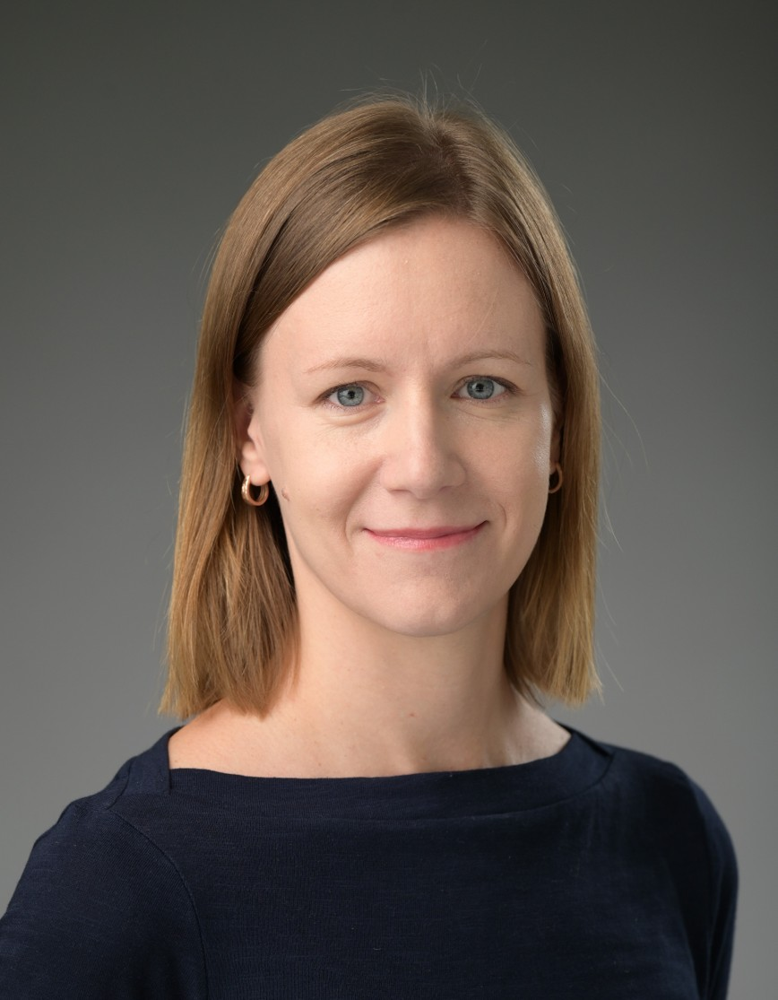
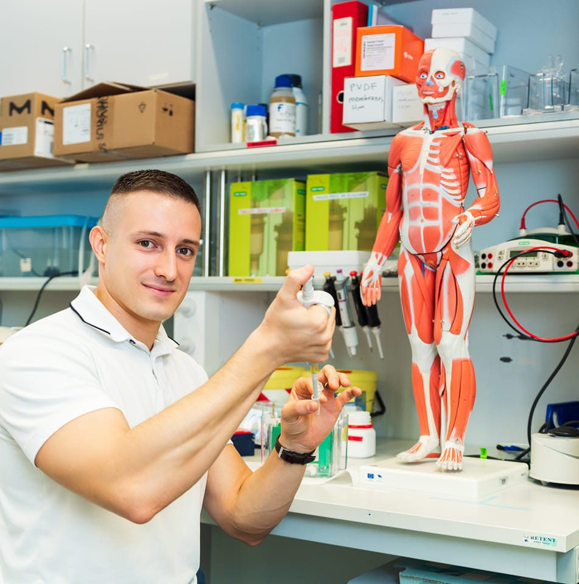
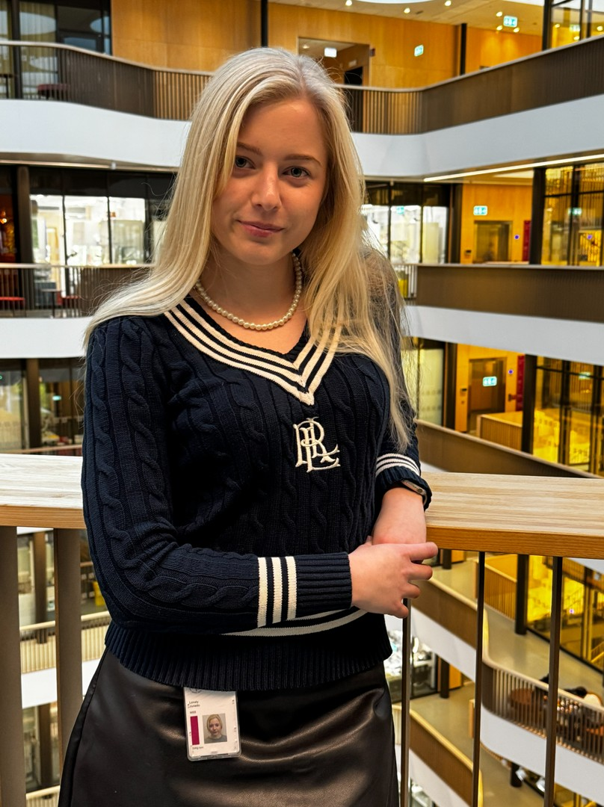
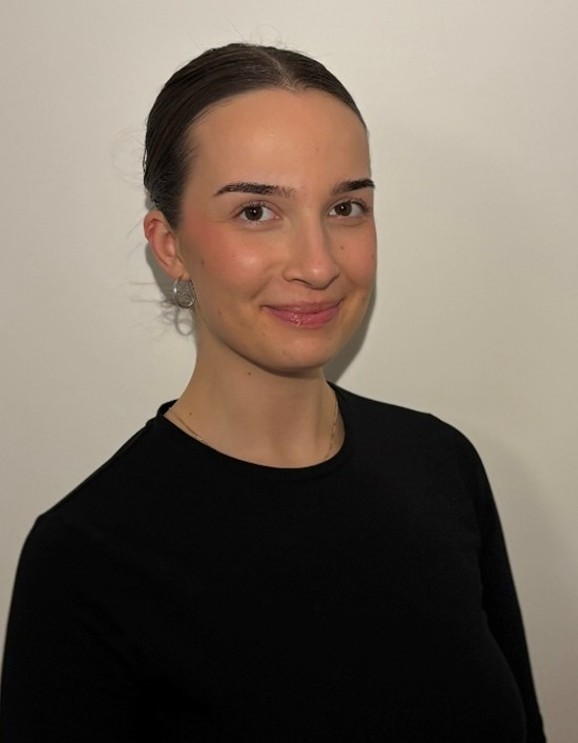
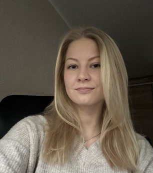
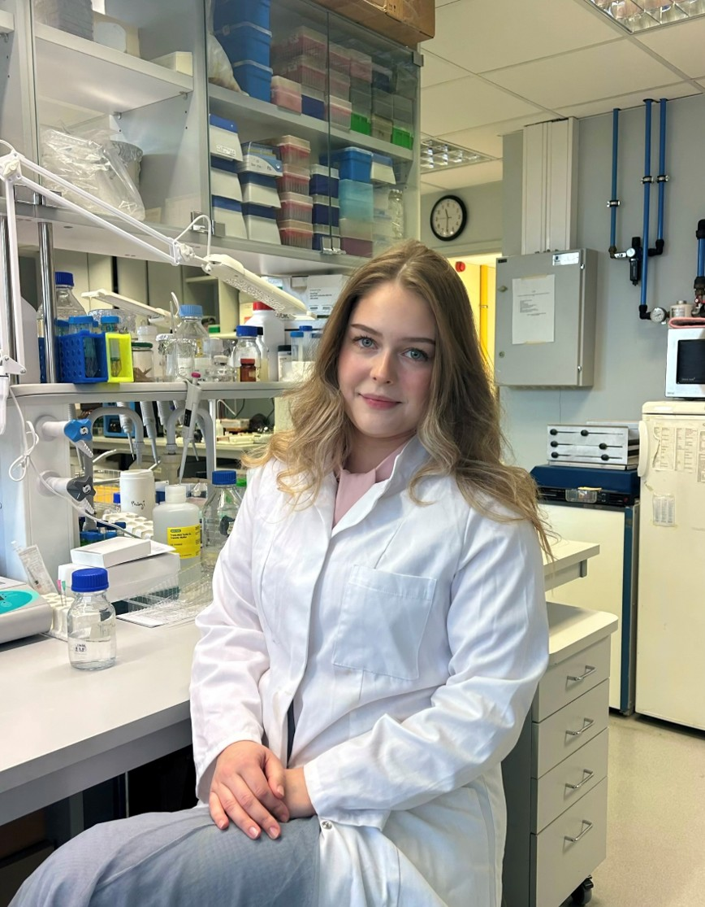

::: {layout="[[32,70]]"}
{fig-align="left" width="240"}  

### Kärt Mätlik, Ph.D.  
<b>Group Leader</b>  
Kärt received her Ph.D. in Physiology and Neuroscience from the University of Helsinki, where she studied the role of neurotrophic factor regulation in midbrain dopamine system function under the mentorship of Jaan-Olle Andressoo and Mart Saarma. For her postdoctoral training, Kärt joined the Laboratory of Developmental Neurobiology at Rockefeller University, led by Mary E. Hatten, where she investigated how chromatin modifications control cerebellar development. Kärt now runs the Neuroepigenetics research group at the Tallinn University of Technology, where she studies the intersection of epigenetics, gene expression and brain development.  

:::

::: {layout="[[32,70]]"}
{fig-align="left" width="240"}  

### Romain Jacques Elie Bernasconi, Ph.D.  
<b>Research scientist</b>  
Romain holds a Ph.D from Taltech, where he investigated cell signalling driving skeletal muscle phenotype adaptation in creatine-deficient mice. Nowadays, Romain works on the characterization of a new EZH1 conditional KO mouse model, in order to further understand EZH1's role in epigenetic regulation. As a side project, he investigates a novel gut-brain epigenetic regulation during neurodevelopment.

:::

::: {layout="[[32,70]]"}
{fig-align="left" width="240"}  

### Lonaly Jüriado, M.Sc.  
<b>PhD Student</b>  
Lonaly holds a Master’s Degree in Forensic Science from Uppsala University, but she conducted her thesis work at the Karolinska Institute, where she investigated mitochondrial gene expression and its potential role in KRAS-driven lung adenocarcinoma. She has now joined the Neuroepigenetics research group at TalTech as a PhD student, where she studies cell-type-specific changes in histone modifications, chromatin organisation, and DNA repair in the ageing mammalian brain. Outside the lab, Lonaly enjoys reading good novels and gardening.

:::

::: {layout="[[32,70]]"}
{fig-align="left" width="240"}  

### Irma Laas, M.Sc.  
<b>PhD Student</b>  
Irma holds a Master's Degree in Biotechnology from Lund University, where she investigated the role of mitochondria-related genes in cancer incidence. She has now joined the Neuroepigenetics research group in TalTech to study chromatin bivalency and the mechanisms and functions of H3K27 trimethylation in developing and mature neurons, with the broader aim of understanding how epigenetic regulation influences neuronal identity and function. Outside the lab, Irma spends her time in pottery classes or practicing folk dance.

:::

::: {layout="[[32,70]]"}
{fig-align="left" width="240"}  

### Aveli Schneider  
<b>BSc Student</b>  
Aveli is a Bachelor’s Degree student in Gene Technology. Before starting university, she graduated from Pärnu Koidula Gymnasium. For her thesis, she focuses on evaluating how the loss of H3K27me3 impacts neurons' susceptibility to DNA damage. In her free time she enjoys reading  books, practicing folk dance and spending time with her cats.  

:::

::: {layout="[[32,70]]"}
{fig-align="left" width="240"}  

### Sarah-Elisabeth Soitu, B.Sc.  
<b>MSc Student</b>  
My thesis focuses on the regulation of bivalent domains in human pluripotent stem cells (hPSCs) and hPSC-derived neurons. I’ve always been fascinated by neuroscience, and the complexity of the brain. When I first learned about stem cells, I was really intrigued by them, so I was happy to get the opportunity to work with them and contribute to research in this exciting area. Neuroepigenetics research group perfectly combines these interests and allows me to explore the importance of epigenetic mechanisms in brain development. Outside the lab, I love painting and listening to science and creativity podcasts. For me, science and art are deeply connected, and both inspire the way I see the world!  

:::

### Karolina Barbara Viks
<b>BSc Student</b>  
Karolina graduated with highest honors from the Old Town Educational College´s (Vanalinna Hariduskolleegium) medical class. Following her graduation, she enrolled in the Applied Chemistry and Gene Technology bachelor’s program at TalTech, specializing in gene technology from her second year onwards. During her second year, she joined TalTech’s Neuroepigenetics research group, where she is conducting her thesis research under the supervision of Dr. Kärt Mätlik. Additionally, Karolina completed a three-week internship at the SOLARIS National Synchrotron Radiation Centre in Poland.  
  
  
  
### Liisa Lepmets
<b>BSc Student</b>  
  
   
  
### Alumni
Liisi Mets, BSc student

